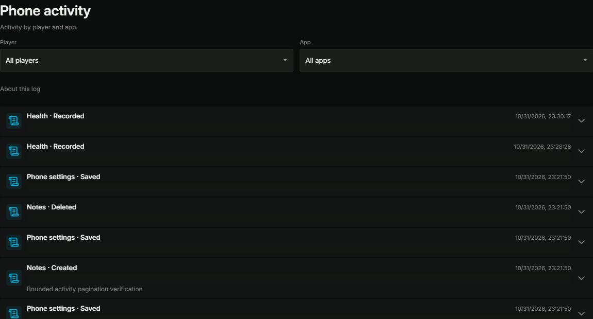

# Phonepanel activity and social inspection verification

The update adds persistent history for successful Phone actions and player-scoped
inspection of Feather, FlipTok, Picstagram, SkyPic Spotlight, SkyPic Stories and
Weazel News. Other apps are represented by their catalogued activity; this does
not add a private-content browser for every installed app. Recording begins with
this update and does not reconstruct earlier actions.

## Runtime and deployment

The local ESX runtime was tested with experimental OAL enabled, FXServer artifact
38004 and the actual FiveM CEF reporting Chromium 144.0.7559.264. Requests used the
real NUI HTTPS callbacks, Phone client bridge, server authorization and database.
MCP managed the resource, callback probes and profiler. DevTools inspected the
loaded resource, controls, requests, images and JavaScript errors.

`build_frontend.bat` generated the NUI and invoked the normal copy workflow for
ESX and Qbox. Only the connected ESX runtime was restarted and exercised. A Qbox
copy is not Qbox gameplay acceptance. SHA-256 comparison of all 577 resource
files found no differences between source and either deployed copy.

Actual FiveM CEF capture after the final build. Actor metadata is masked for
privacy; the selected scope is All players. Rows without preview text are 57
pixels tall, with device identifiers available on expansion.

## Functional verification

- Real Notes create/update/delete operations appeared with the expected actor,
  device and content. A stale update returned a conflict and did not create a
  success record. Test notes were removed and the original Notes count checked.
- A bounded managed probe created and immediately removed 23 unique QA notes to
  exercise multiple activity pages. This exposed string-alias sorting of BIGINT
  IDs. The fixed query orders and filters the qualified numeric database column;
  response IDs remain strings. Subsequent live page reads were descending and
  did not overlap.
- The activity view renders one bounded page and formats details on expansion.
  Database timestamps are presented as local dates and times. Device identifiers
  are inside expanded details rather than repeated in the summary rows.
- Isolated database fixtures exercised all six content views without attaching
  accounts to a real phone, changing inventory or replacing a character's device
  preference. A QA SIM established the existing server-owned association.
- Public reads excluded drafts, archived posts and friends-only Stories. Scoped
  reads included them. Picstagram captions of 720 characters and a Weazel article
  of 1,026 characters were returned in full; attachment hydration was verified.
- Global deletion rejected a draft and a friends-only Story. Scoped deletion of
  owned QA posts succeeded, and the resulting state was read back. Invalid IDs
  and unavailable player targets returned errors.
- Fixture cleanup confirmed zero QA accounts, devices, SIMs, media and Weazel
  articles. The fixtures never changed real inventory or an active account link.
- Actual CEF interaction verified compact list rows, expanding captions and
  loaded images. A WebM sample played with readyState 4 and no media error; an
  MP4 sample exercised the unavailable-attachment fallback. The actual confirm
  dialog removed a QA post and refreshed the public list without manual reload.
  Browser regressions cover stale player responses, failed-page
  retry, exact cursors, locale evaluation and media/error states.
- The final CEF layout was also checked at an emulated 1280×720 viewport and the
  original viewport restored. Secondary pagination actions remain compact with
  44-pixel targets and white foregrounds.

The second client was present for the initial callback measurements and content
matrix, then disconnected. The unavailable-target result was verified. Final
simultaneous two-player and Qbox gameplay acceptance were not performed.

The fixtures are administrative read/moderation fixtures; they do not establish
that every social app's publishing workflow was retested end to end.

## Performance evidence and limits

The real callback code executed against deterministic SQL fixtures uses four
queries to bootstrap 128 players, compared with 258 before the change. The
periodic statistics endpoint uses one query and does not hydrate devices, parse
app JSON or reload audit history. Timestamp and category indexes support the
new read paths.

The live empty-category EXPLAIN used `idx_sky_phone_activity_category` with a
ref lookup and an estimated one row instead of scanning the retained history.

The account-notification regression uses 1,005 open sessions, with only four
matching sessions entering the original authorization checks; two remain
authorized to receive the event. Matching recipients are still revalidated.

Nine bootstrap roundtrips per client were measured before and after: one client
changed from a 161 ms to 138 ms median; the local client changed from 121 ms to
129 ms. Packed response size stayed 3,731 bytes in that comparison. These mixed
network samples are not evidence of a universal latency or FPS improvement.

Both server profiler captures contain 200 recorded frames; comparison uses 199
complete frames after boundary exclusion. Background gameplay continued, so the
captures are diagnostic evidence rather than a controlled production-load
benchmark. Raw traces, receipts and screenshots containing player data remain
private and are not included in the repository.

MCP NUI capture could not start because its host already contained 200 run
records. Existing diagnostics were preserved; direct CEF DevTools were used for
the UI observations instead.

A parameterized MCP scenario and its managed snippet were saved for the Notes
and pagination regression. The host scenario could not start for the same
record-capacity reason. Its managed snippet was run directly and completed with
23 notes created/removed, two non-overlapping 40-entry pages, exact cursors,
device filtering, no owned timers/threads and the original Notes count intact.

See [the activity history contract](admin-phone-activity.md) for persistence,
retention, redaction, source identity and migration details.

## Automated checks

The completed local checks include 1,912 Vitest assertions across 265 files,
77 browser mock endpoints, all 83 Lua test files, syntax checks for 298 Lua
files, the 64-case full browser/theme suite, ESLint, TypeScript, license parity
and the repository policy validator. The four affected browser scenarios were
rerun after the final pagination presentation adjustment.
